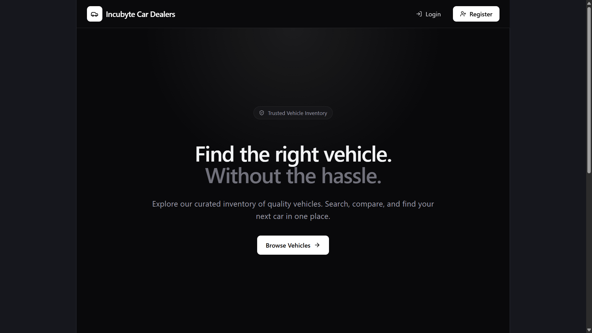
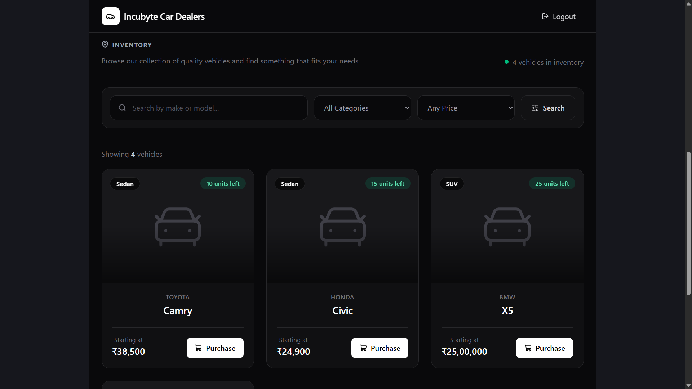
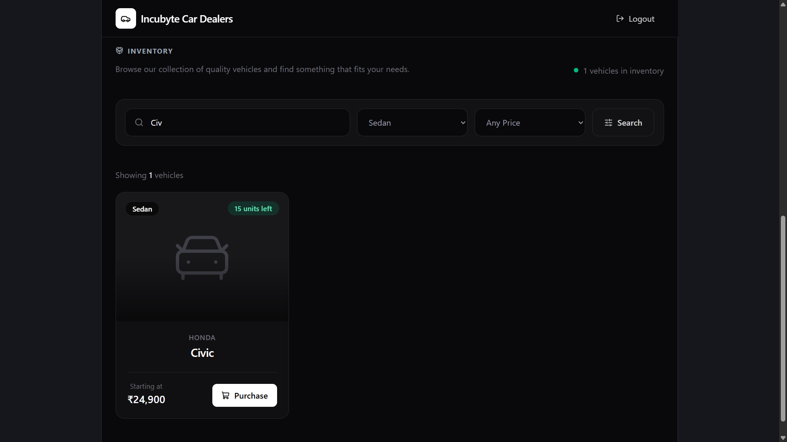
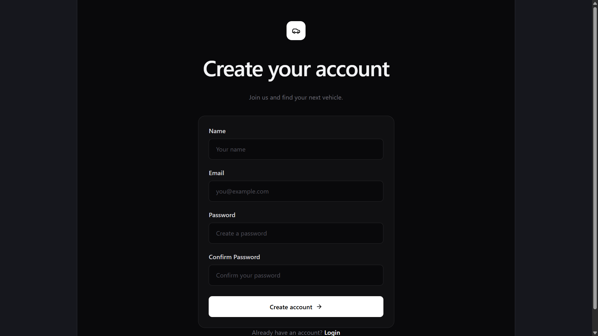
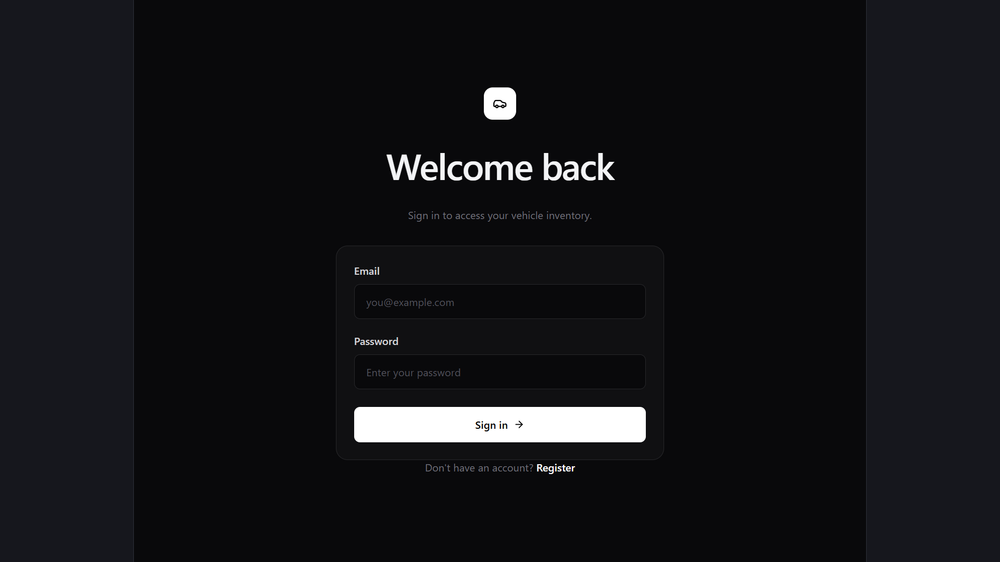
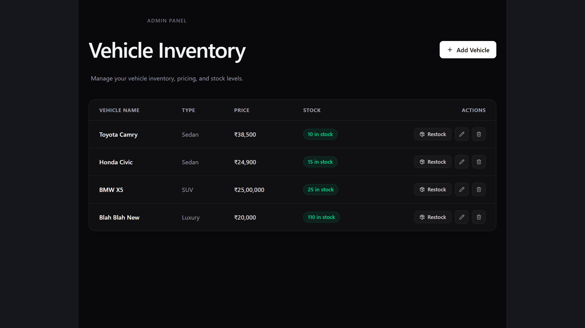
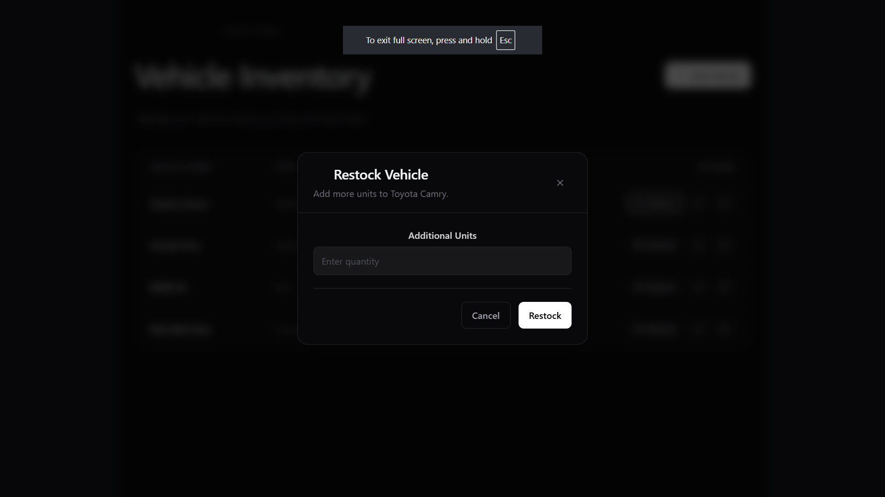
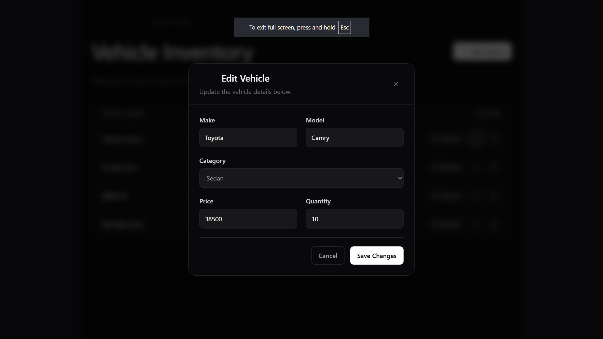

# Car Dealership Inventory System

A full-stack Car Dealership Inventory System built with React, TypeScript, Node.js, Express, and MongoDB.

The application provides vehicle inventory management, user authentication, vehicle search, purchasing, restocking, and admin-only inventory operations.

Live Demo: https://car-dealership-inventory-system-c8g.vercel.app/

## Features

### User Features

- User registration
- User login
- JWT-based authentication
- Browse available vehicles
- Search and filter vehicles
- View vehicle price and stock availability
- Purchase vehicles
- Purchase confirmation dialog
- Automatic stock reduction after purchase
- Purchase button disabled when a vehicle is out of stock

### Admin Features

- Admin authentication and protected admin routes
- View complete vehicle inventory
- Add new vehicles
- Restock existing vehicles
- Delete vehicles
- View/edit/update current stock levels, pricing and categories

## Tech Stack

### Frontend

- React
- TypeScript
- Vite
- Tailwind CSS
- React Router
- Axios
- Lucide React

### Backend

- Node.js
- TypeScript
- Express
- MongoDB
- Mongoose
- JWT
- bcrypt
- CORS

### Testing

- Jest
- Supertest
- ts-jest

### Deployment

- Vercel
- MongoDB Atlas

## Project Structure(AI Generated)

```text
Car-Dealership-Inventory-System/
│
├── backend/
│   ├── src/
│   │   ├── config/
│   │   ├── controllers/
│   │   ├── middleware/
│   │   ├── models/
│   │   ├── routes/
│   │   ├── app.ts
│   │   └── server.ts
│   │
│   ├── test/
│   ├── package.json
│   └── tsconfig.json
│
├── frontend/
│   ├── src/
│   │   ├── api/
│   │   ├── components/
│   │   ├── pages/
│   │   ├── types/
│   │   └── App.tsx
│   │
│   ├── package.json
│   ├── tsconfig.json
│   ├── vite.config.ts
│   └── vercel.json
│
├── PROMPTS.md
└── README.md
```

## Backend API

### Authentication

| Method | Endpoint | Description |
|---|---|---|
| POST | `/api/auth/register` | Register a new user |
| POST | `/api/auth/login` | Login and receive JWT |

### Vehicles

| Method | Endpoint | Description |
|---|---|---|
| POST | `/api/vehicles` | Add a new vehicle |
| GET | `/api/vehicles` | Get all vehicles |
| GET | `/api/vehicles/search` | Search vehicles |
| PUT | `/api/vehicles/:id` | Update vehicle |
| DELETE | `/api/vehicles/:id` | Delete vehicle |
| POST | `/api/vehicles/:id/purchase` | Purchase a vehicle |
| POST | `/api/vehicles/:id/restock` | Restock a vehicle |

Protected endpoints require JWT authentication.

Admin-only operations require an authenticated admin user.

## Authentication

The backend uses JSON Web Tokens (JWT) for token-based authentication.

After login, the frontend stores the authentication token and sends it with protected API requests.

Passwords are hashed using bcrypt before being stored in the database.

## Database

The application uses MongoDB Atlas as the persistent database.


## Local Setup

### Prerequisites

Make sure you have:

- Node.js installed
- npm installed
- MongoDB Atlas account or MongoDB instance
- Git

### Clone the Repository

```bash
git clone https://github.com/CshardZ/Car-Dealership-Inventory-System.git
cd Car-Dealership-Inventory-System
```

## Backend Setup

Navigate to the backend:

```bash
cd backend
```

Install dependencies:

```bash
npm install
```

Create a `.env` file:

```env
MONGODB_URI=your_mongodb_connection_string
DB_NAME=car_dealership
JWT_SECRET=your_jwt_secret

NODE_APP_ENVIRONMENT=DEVELOPMENT
PORT=3000

NODE_CLIENT_DEVELOPMENT_URL=http://localhost:5173
NODE_SERVER_DEVELOPMENT_URL=http://localhost:3000
```

Start the backend:

```bash
npm run dev
```

The backend will run at:

```text
http://localhost:3000
```

Health check:

```text
http://localhost:3000/api/health
```

## Frontend Setup

Open another terminal and navigate to the frontend:

```bash
cd frontend
```

Install dependencies:

```bash
npm install
```

Create a `.env` file:

```env
VITE_API_URL=http://localhost:3000/api
```

Start the frontend:

```bash
npm run dev
```

The frontend will normally run at:

```text
http://localhost:5173
```

## Testing

The backend uses Jest and Supertest for API testing.

Run the test suite from the `backend` directory:

```bash
npm test
```

### Test Results

The final backend test suite contains:

```text
Test Suites: 3 passed, 3 total
Tests:       15 passed, 15 total
```

Tested areas include:

- Health endpoint
- User authentication
- Vehicle API operations
- Protected routes
- Admin functionality
- Vehicle inventory operations

## Screenshots

### Home / Vehicle Inventory





### Registration/Login




### Admin Dashboard






## Deployment

The application is deployed using Vercel.

The frontend communicates with the deployed Express backend through the configured:

```env
VITE_API_URL
```

The backend uses MongoDB Atlas for production database connectivity.

Production environment variables are configured through the Vercel dashboard rather than committed to the repository.

## Environment Variables

### Backend

```env
MONGODB_URI=
DB_NAME=
JWT_SECRET=

NODE_APP_ENVIRONMENT=
PORT=

NODE_CLIENT_DEVELOPMENT_URL=
NODE_SERVER_DEVELOPMENT_URL=

NODE_CLIENT_PRODUCTION_URL=
NODE_SERVER_PRODUCTION_URL=
```

### Frontend

```env
VITE_API_URL=
```


## My AI Usage

I used ChatGPT as an AI development assistant throughout the project.

### How I Used AI

I used ChatGPT for several parts of the development workflow, including:

- How to write good commit names for github repository projects
- Designing and reviewing REST API endpoints
- Designing frontend - UI/UX recommendations
- Debugging backend and frontend errors
- Implementing frontend API calls for authentication and vehicle operations.
- Implementing purchase, restock, delete, and add-vehicle interactions
- Understanding and troubleshooting CORS issues between the frontend and backend
- Fixing MongoDB Atlas connectivity during Vercel deployment.
- Reviewing API responses and frontend state updates
- Getting guidance on testing and deployment configuration.


## AI Prompt Logs

The repository contains a `PROMPTS.md` file containing the raw AI conversations/prompts used during development.
